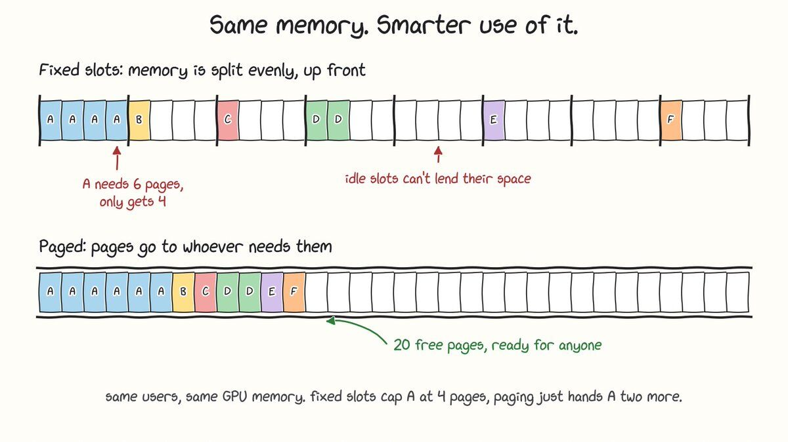
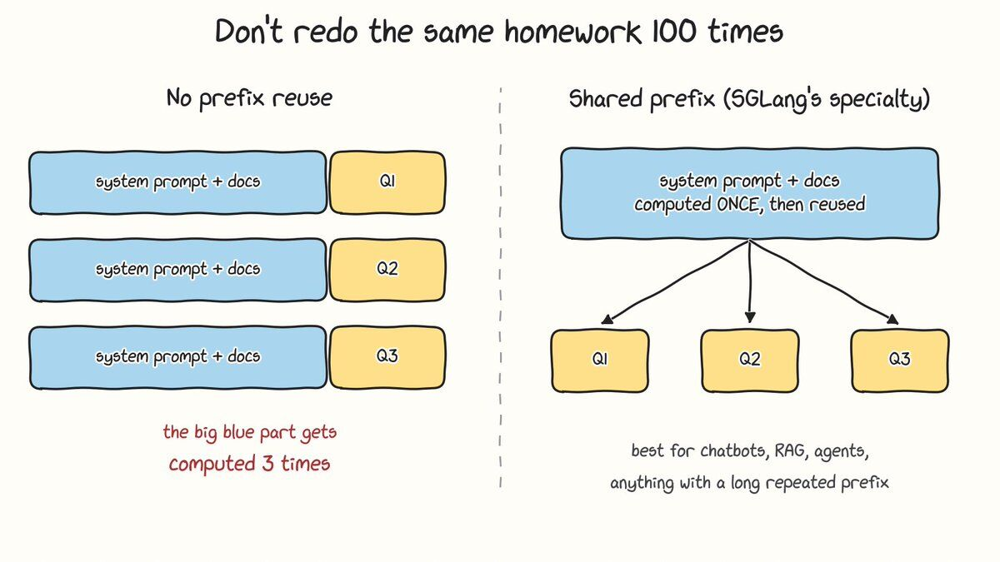

Many people don't realize this, but the inference engine is as important as the LLM itself. It decides your tokens/sec and your time to first token, and it also affects how well the model you picked actually performs.

For the development of my first product, we tried running an SLM on a CPU-only machine (I know, I know, it's dumb, but stay with me). Our testing told us the obvious: LLMs need a GPU. So we migrated to a GPU machine. At that point we were using llama.cpp as our inference engine. During testing we saw we were barely using any of the GPU, and the tokens/sec were still nowhere near acceptable. We backtracked and found the problem was the inference engine. It just wasn't designed for our use case. Don't get me wrong, llama.cpp is one of the best inference engines out there. It just wasn't for us (multi-user, high throughput).

There are plenty of engines: vLLM, SGLang, TensorRT-LLM, llama.cpp. There isn't a clear best one, because they're all designed for different purposes. So here's a breakdown of what each one is built for and when to use it. Hopefully it helps you find the right one for your use case.

## So what does an inference engine actually do?

The model is a giant pile of numbers. The engine turns those numbers into tokens for real people. It loads the weights, decides which requests run together, manages the memory that holds every conversation (the KV cache), and launches the GPU kernels that do the math.

Here's the part that surprised us. Generating tokens for a single user barely stresses a modern GPU, because the chip spends most of its time waiting on memory. You only get your money's worth by serving lots of users in the same pass. Whether an engine can do that well is the whole game.

## What went wrong for us

Let me say it again before the comments do: llama.cpp is not slow. Our workload was the wrong shape for it.

If you hit the same wall, check two things first. GPU usage in llama.cpp depends on how many layers you offload, and it does have parallel slots with continuous batching. The flags are `--n-gpu-layers`, `--parallel` and `--cont-batching`. Even tuned, the design tradeoff shows up at scale. In Red Hat's H200 test with Llama 3.1 8B, vLLM produced roughly 44 times more tokens per second than llama.cpp at 64 simultaneous users, and llama.cpp's worst-case time to first token grew past three minutes. Red Hat also flags that this is a high-concurrency test on a data center GPU, which plays to vLLM's strengths. Their earlier A100 test found the same pattern with Ollama, which runs on llama.cpp. Ollama peaked at 41 tokens/sec against vLLM's 793, even after being tuned for 32 parallel requests. (How to Serve LLM Completions (With llama.cpp)? - Resonance +2)

The reason comes down to memory. llama.cpp's server splits the context window into fixed slots. Give it 32K of context and 8 slots and every slot gets 4K, whether or not anyone is using it. One user pasting a long document hits the wall while other slots sit idle. vLLM uses paging instead, so a sequence takes blocks as it grows and returns them when it finishes. (Trivconsulting)

## What to measure before picking anything

- Throughput at your real concurrency. Ten users and a hundred users are different problems.
- Time to first token at p95, not the average. Your unluckiest users are the ones who leave.
- Cold start. It matters if you autoscale or deploy new models often.

Red Hat used an open-source tool called GuideLLM for its tests, and it's a good starting point for benchmarking with your own traffic.

## The engines

### llama.cpp

It was built to run models on hardware you already own. It is CPU-first, with optional GPU acceleration, and it introduced the GGUF single-file format. Ollama and LM Studio run on top of it. Pick it for laptops, Macs, edge devices, offline use, and quickly swapping GGUF files. Skip it when many users hit one GPU server. (Red Hat)

### vLLM

This is the general-purpose workhorse. It uses PagedAttention and continuous batching, so new requests join the running batch instead of waiting. It has the widest model support of the three big engines, needs no compile step, and started serving in about 62 seconds in Spheron's H100 test. It also runs on NVIDIA, AMD, Intel and CPU targets. Pick it when you have many users, many models, or a small team. Its peak throughput is a bit lower than TensorRT-LLM's. (Spheron)(vercel)

### SGLang

Its trick is RadixAttention. Requests that share a prefix (a system prompt, a document, few-shot examples) reuse the cached computation instead of redoing it.

The gain depends entirely on how much your requests overlap. Runpod reports SGLang at about 16,200 tok/s against vLLM's 12,500 on prefix-heavy Llama 3.1 8B traffic, but within a few percent of each other on unique prompts. Spheron's rule of thumb is to choose SGLang above roughly 60% shared-prefix traffic, and below that to use vLLM with prefix caching switched on. Pick it for chatbots, RAG, agents and multi-turn products. (RunpodSpheron)

### TensorRT-LLM

This is NVIDIA's compiler approach. It builds an optimized engine for your specific model and GPU, and it wins on raw speed. On Llama 3.3 70B FP8 on one H100, it hit 2,100 tok/s at 50 concurrent users against vLLM's 1,850, with the lowest time to first token at every load level. The cost is that the compiled build took about 28 minutes per model version. It is also NVIDIA-only and has a steeper setup curve. Since v1.0 there is a PyTorch backend that loads Hugging Face weights directly and starts in roughly 60 to 90 seconds, with lower peak throughput. Pick it when you serve one stable model for months and every last token/sec matters. (vLLM vs TensorRT-LLM vs SGLang: Which Is Fastest? (H100 Benchmarks, 2026) | Spheron Blog +3)

## Honorable mentions

Hugging Face's TGI went into maintenance mode on March 21, 2026, and the project now points new users to vLLM, SGLang, llama.cpp and MLX. If you run multiple nodes, orchestration layers like llm-d and NVIDIA Dynamo sit above these engines rather than replacing them. (VRLA Tech)

## The part nobody talks about: the engine touches output quality

I said at the top that the engine affects how your model performs. Here's what I mean.

1. Quantization and format. GGUF is llama.cpp's home turf. vLLM can load GGUF, but it is under-optimized there, and AWQ INT4 is the usual best-practice format for vLLM serving. Quantization trades some quality for memory, so the format you end up with depends on the engine you picked. dev
2. Templates and parsers. Chat templates, tool-call parsing and reasoning parsers all live in the serving layer. A paper on inference verification notes that identical open-weight models have shown different performance across providers, consistent with differences in templates, quantization and serving stacks. arxiv
3. Batching changes the math. Temperature 0 does not guarantee identical outputs. Thinking Machines found that 1,000 completions of the same prompt on Qwen3-235B at temperature 0 produced 80 distinct outputs. The cause is that a request's output depends on the batch size of the forward pass, because the kernels aren't batch invariant. Batch-invariant kernels fix it, but they are slower than the defaults. MediumThinkingmachines

So if you need reproducible outputs, test that under load, not just on a quiet dev box.

## So which one do I pick?

The short version:

- Just you or a small team, or a laptop, Mac, CPU or edge device: llama.cpp (or Ollama / LM Studio).
- Many users on GPUs and you're unsure: vLLM.
- Many users and lots of shared prefix: SGLang.
- One stable model, NVIDIA GPUs, maximum throughput: TensorRT-LLM.

My honest advice is to start with vLLM, benchmark with your own traffic, and only move if the numbers tell you to. Switching is cheap. Both llama.cpp and vLLM expose an OpenAI-compatible endpoint, so swapping is mostly a URL change, and the same goes for vLLM, SGLang and TensorRT-LLM. (Red Hat)(Spheron)

We lost time because we picked an engine for the wrong workload, not because we picked a bad one. Before you pick, write down how many users you expect, how long their prompts are, and how much of each prompt repeats. That answer usually picks the engine for you.

## References

- Spheron, "vLLM vs TensorRT-LLM vs SGLang: Which Is Fastest? (H100 Benchmarks, 2026)" (updated Aug 19, 2026). Throughput, TTFT and cold-start numbers, PyTorch backend, and the 60% shared-prefix rule of thumb. <https://www.spheron.network/blog/vllm-vs-tensorrt-llm-vs-sglang-benchmarks/>
- Runpod, "vLLM vs TensorRT-LLM vs SGLang: Which Inference Engine to Deploy" (June 2026). SGLang vs vLLM on prefix-heavy traffic. <https://www.runpod.io/articles/comparison/vllm-vs-tensorrt-llm>
- Red Hat Developer, "llama.cpp vs. vLLM: Choosing the right local LLM inference engine" (June 2026). The 44x throughput gap at 64 users, TTFT, and OpenAI-compatible endpoints. <https://developers.redhat.com/articles/2026/06/15/llamacpp-vs-vllm-choosing-right-local-llm-inference-engine>
- Red Hat Developer, "Ollama vs. vLLM: A deep dive into performance benchmarking" (Aug 2025, updated July 2026). The 41 vs 793 tok/s A100 comparison. <https://developers.redhat.com/articles/2025/08/08/ollama-vs-vllm-deep-dive-performance-benchmarking>
- Tri V Holdings, "Ollama vs vLLM vs llama.cpp: Which LLM Server Should You Run?" (July 2026). Fixed slot splitting vs paged KV cache. <https://trivconsulting.com/blog/ollama-vs-vllm-vs-llama-cpp>
- Vercel, "ollama vs vllm". vLLM hardware targets. <https://vercel.com/i/ollama-vs-vllm>
- VRLA Tech, "vLLM vs Ollama vs llama.cpp vs SGLang 2026". TGI maintenance mode and TensorRT-LLM being NVIDIA-only. <https://vrlatech.com/llm-inference-engine-comparison-2026/>
- Resonance, "How to Serve LLM Completions (With llama.cpp)". The llama.cpp server flags for GPU offload, parallel slots and continuous batching. <https://resonance.distantmagic.com/tutorials/how-to-serve-llm-completions/>
- Jovan Chan, "GPTQ vs AWQ vs GGUF for vLLM 2026" (DEV Community). Quantization formats per engine. <https://dev.to/jovan_chan_9500711396d4e6/gptq-vs-awq-vs-gguf-for-vllm-2026-which-4-bit-wins-56bm>
- Horace He and Thinking Machines Lab, "Defeating Nondeterminism in LLM Inference" (Sep 2025). Batch invariance. <https://thinkingmachines.ai/blog/defeating-nondeterminism-in-llm-inference/>
- Sulbha Jain, summary of the Thinking Machines post (Medium). The 80 distinct outputs in 1,000 runs. <https://sulbhajain.medium.com/defeating-nondeterminism-in-llm-inference-thinking-machines-2339599e4156>
- "Verifying LLM Inference to Detect Model Weight Exfiltration" (arXiv 2511.02620). Cross-provider differences from templates, quantization and serving stacks. <https://arxiv.org/pdf/2511.02620>
