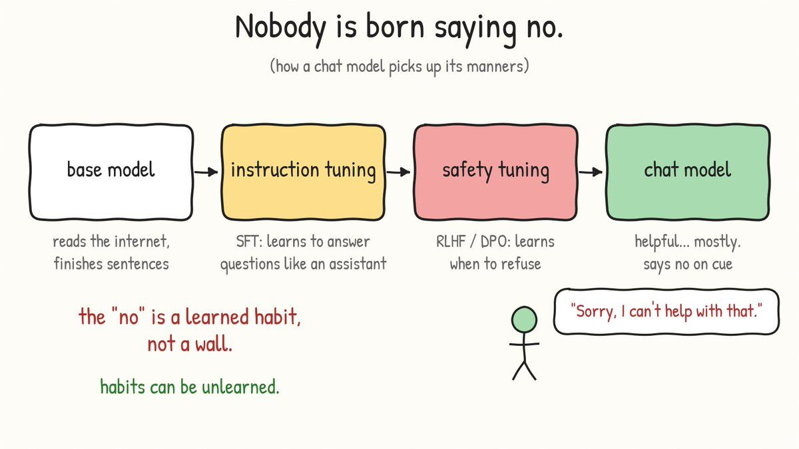
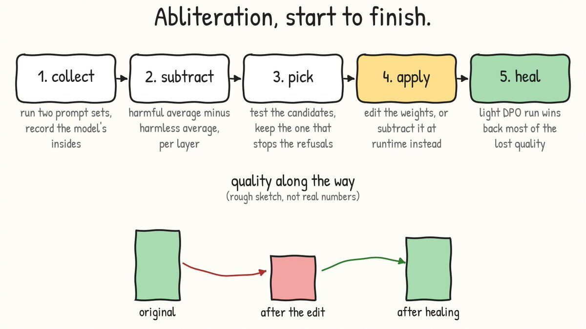
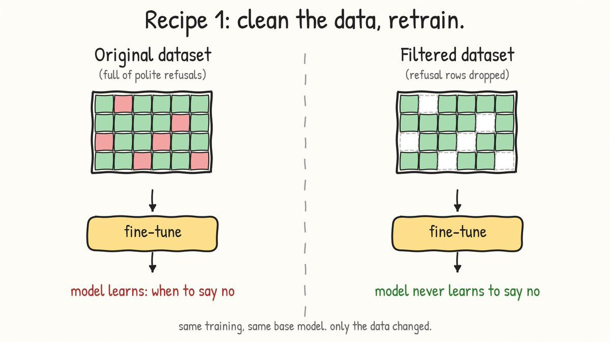
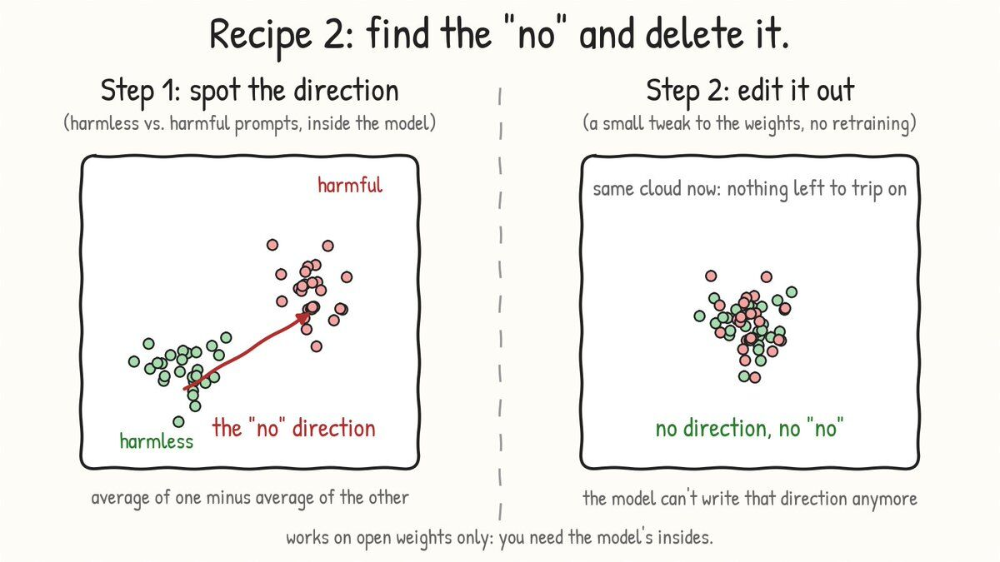
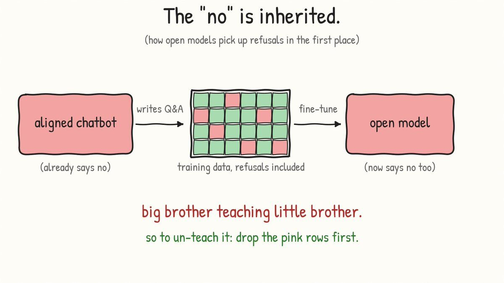
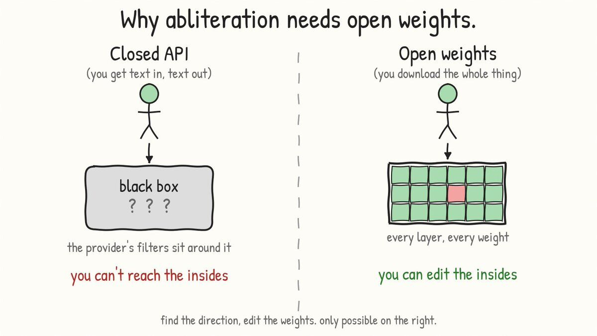
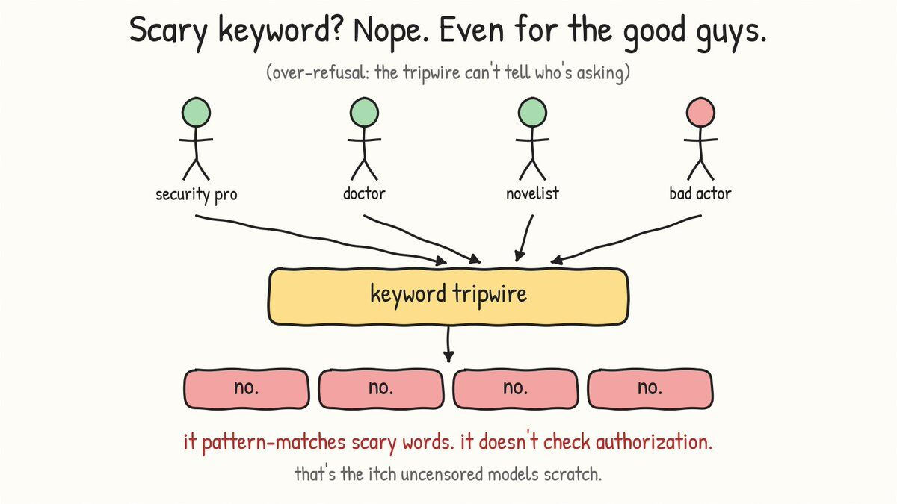
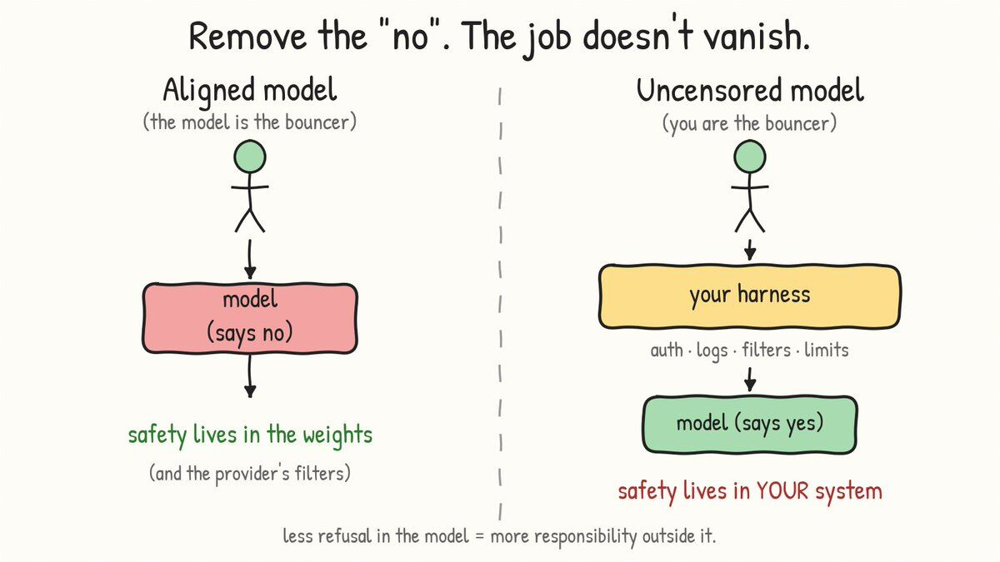
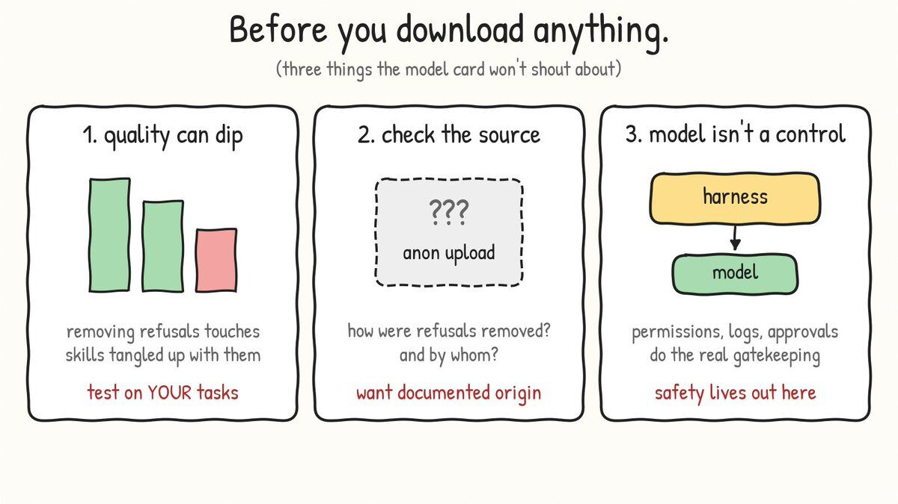

Spoiler: nobody rips out a "censorship module." There isn't one.

You've probably seen the label on Hugging Face. "Uncensored." "Abliterated." "Unfiltered."

It sounds like someone found the safety switch and flipped it. Reality is funnier, and a lot more interesting.

Let's jump into it.

## First: what does "uncensored" even mean?

There's no industry standard. Some people use the word for a model with light refusal tuning. Others mean a model released with no safety layer at all.

The useful definition: an uncensored model is one that refuses less by itself, so more of the "should we answer this?" decision moves to the system around it. [1]

Keep that last part in mind. We'll come back to it.

## Where the "no" comes from

A model isn't born polite. It gets there in stages.

- Base model. Trained on huge piles of text. It finishes sentences. It doesn't "assist" anyone.
- Instruction tuning (SFT). Trained on question/answer pairs so it behaves like an assistant.
- Safety tuning (RLHF / DPO). Humans (or other models) rank answers, and the model is nudged toward the ones that are helpful and away from the ones that aren't. [4][5]

Refusing is a learned behavior, and that's the whole trick. It's a habit the model picked up in stage 2 and 3, not a wall bolted on afterwards.

Habits can be unlearned. There are two popular ways.

## Recipe 1: clean the data, retrain

This is the classic route, popularized by Eric Hartford with his "uncensored" WizardLM and Vicuna releases. It's also the least mysterious one: no clever math, just better homework.

### Where the refusals come from

Open models of that era were built in two moves: start from a base model like LLaMA, then fine-tune it on an instruction dataset so it learns to be helpful, obey the user and hold a conversation. [3]

Where does that instruction dataset come from? Very often, from asking an already-aligned chatbot to write the questions and answers. Hartford's description of what happens next is my favorite line in the whole space: the alignment gets passed down "like a big brother teaching little brother." [3]

And the refusals aren't subtle. They're literally rows in the dataset. The example he shows is a "secret spy message" puzzle that gets answered with a polite little speech about how the assistant can't help with anything illegal or unethical. [3]

Train on enough rows like that and the model learns three things: that it can refuse, when to refuse, and how to word the refusal. Which is to say, it learns alignment. [3]

### Step 1: filter the dataset

The strategy is deliberately boring: identify and remove as many refusals and biased answers as you can, keep everything else. [3]

In practice that's a script that goes through the dataset and flags refusal-style answers. Hartford didn't start from zero here. Someone had already built a filter for the Vicuna dataset, so he rewrote that script to work on the WizardLM one, then published the cleaned result as a new dataset. [3]

### Step 2: retrain the exact same way

Here's the part people don't expect: nothing about the training changes. You take the base model and train it on the filtered data using the very same procedure as the original model's training. [3]

So this is real training, not a quick tweak. For the 7B WizardLM run, Hartford used a rented node with four 80GB A100 GPUs, ran three epochs, and it took on the order of a day, including some babysitting because of a checkpoint-saving bug. [3]

### Step 3: test it against the original

Then you do the obvious sanity check. Feed the new model the kind of request the aligned version turns down, and compare. Hartford's test was a request for an over-the-top insult, which ChatGPT declined with a polite paragraph about ethical guidelines. His model, by contrast, was noticeably more compliant. [3]

### What you get, and what you don't

The model didn't learn anything new. It just never saw examples of saying no, so it never picked up the habit. Same knowledge, same architecture, different manners.

The flip side: the result is only as clean as your filter. Miss a batch of refusals and a bit of the old behavior leaks back in. And since it's a full fine-tune, you pay for it in GPU hours.

This is also the idea behind the Dolphin family of models: fine-tune on instruction data that doesn't teach the model to say no.

## Recipe 2: find the "no" and delete it

This one is stranger, and honestly kind of beautiful.

A 2024 paper (NeurIPS) showed that across 13 open chat models, up to 72B parameters, refusal is mediated by a single direction inside the model. [2]

Quick mental model: as a prompt flows through a transformer, every layer reads from and writes to a shared running state called the residual stream. Think of it as a notebook that every layer scribbles in. The paper found that "I should refuse this" shows up as one specific direction in that notebook. [2][6]

The two-way test is what makes it convincing. Erase that direction and the model stops refusing harmful requests. Add it and the model starts refusing perfectly harmless ones. [2]

So how do you actually use that? In five steps.

### Step 1: collect two piles of prompts

You need a set of harmful instructions and a set of harmless ones, the same number of each. In Labonne's walkthrough that's 256 of each. You run every prompt through the model and record the residual stream at the last token position, the moment right before the model starts to answer. [6]

### Step 2: subtract

For each layer, take the average activation on the harmful prompts, subtract the average on the harmless prompts, and normalize the result. The difference is a candidate "refusal direction." You end up with one candidate per layer. [2][6]

### Step 3: pick the one that works

Not every candidate is any good. So you test them: apply each one, generate answers to a handful of held-out prompts, and see which direction actually stops the refusals. Labonne tried the top 20 candidates, automatically threw out any completion containing phrases like "I cannot," then eyeballed what was left by hand. If nothing works, you try other positions in the stream, other prompts, or more layers. [6]

It's part science, part "does it feel right." That's a useful thing to know before anyone tells you it's a one-click trick.

### Step 4: remove the direction

There are two ways to do it: [6]

- At runtime (inference-time intervention). For every component that writes into the residual stream, compute how much of its output points along the refusal direction and subtract that, at every layer and every token. Nothing is saved; the model just never gets to represent the "no."
- Permanently (weight orthogonalization). Edit the weight matrices that write into the residual stream so they can't write along that direction at all. The paper describes this as an interpretable rank-one weight edit, and says it's simpler and cheaper than fine-tuning. [2]

The second one is what people ship on Hugging Face, and it's where the nickname abliteration comes from. It's no retraining: you're editing weights you already have.

### Step 5: heal the damage

Here's the honest part. The edit isn't free. Labonne benchmarked his abliterated model against the original and saw the scores drop across the board. It was uncensored, but it was also a bit dumber. [6]

His fix was a short round of preference tuning (DPO) on top, about six and a half hours on six A6000 GPUs. That recovered most of the lost performance, though not the math benchmark, which he guessed needed more math examples in the training mix. He went with DPO instead of more supervised fine-tuning because instruct models tend to be brittle under SFT, while preference tuning is lighter and less likely to wreck the model. [6]

## The catch: you need the weights

This only works on open models, because you have to be inside to do it.

## Side quest: it's not just for refusals

Labonne points out that abliteration is really "fine-tuning without retraining." Any behavior that lives along a direction can be nudged the same way. His example is a model tuned to sound melancholic. [6]

## Recipe 1 vs Recipe 2, in one breath

Recipe 1 changes what the model learns. It needs training data and real GPU time.

Recipe 2 changes what the model can express. It needs the weights, two small prompt sets, and (ideally) a short healing run.

The paper's own takeaway is a little uncomfortable for the safety crowd: current safety fine-tuning is brittle. [2]

## So why do people want these?

Not everyone asking is up to something. The over-refusal problem is real: a model that trips on scary-looking keywords will happily block the security team, the doctor, the lawyer and the novelist along with the bad actors.

The usual legit cases:

- Security research and red-team simulation
- Internal tools where the company already controls who can ask what
- Prototyping and evals before filters get added
- Medical, legal and creative work that keeps hitting keyword tripwires

## The part nobody puts in the model card

Here's the catch, and it's the whole point of this article.

When the model stops saying no, the "no" doesn't disappear. It moves to you. The application now has to handle authorization, logging, filtering, rate limits and escalation, because the model won't. [1]

Three things worth knowing before you download anything:

1. Quality can dip. Removing refusals touches capabilities that are tangled up with them. Test on your own tasks, not just on leaderboards.
2. Provenance matters. A random anonymous upload is a supply-chain risk. You want to know how the refusals were removed and by whom.
3. The model is a component, not a control. If your model has access to internal data or tools, "it'll probably decline the bad stuff" is not a security posture. Permissions, monitoring and approvals are. [1]

## TL;DR

- Refusal is a learned behavior, not a bolted-on filter.
- Recipe 1: strip refusals from the training data and fine-tune.
- Recipe 2: find the single "refusal direction" in the activations and edit it out (abliteration).
- Uncensored doesn't mean unsafe by default. It means safety becomes your job.

Same GPU. Very different day.

## References

- [1] NHI Mgmt Group, "Uncensored AI Model," AI Security Glossary. <https://nhimg.org/glossary/uncensored-ai-model/>
- [2] A. Arditi, O. Obeso, A. Syed, D. Paleka, N. Rimsky, W. Gurnee, N. Nanda, "Refusal in Language Models Is Mediated by a Single Direction," NeurIPS 2024. <https://arxiv.org/abs/2406.11717>
- [3] E. Hartford, "Uncensored Models." <https://erichartford.com/uncensored-models>
- [4] L. Ouyang et al., "Training language models to follow instructions with human feedback" (InstructGPT), 2022. <https://arxiv.org/abs/2203.02155>
- [5] R. Rafailov et al., "Direct Preference Optimization: Your Language Model is Secretly a Reward Model," 2023. <https://arxiv.org/abs/2305.18290>
- [6] M. Labonne, "Uncensor any LLM with abliteration," Hugging Face blog, June 2024. <https://huggingface.co/blog/mlabonne/abliteration>
